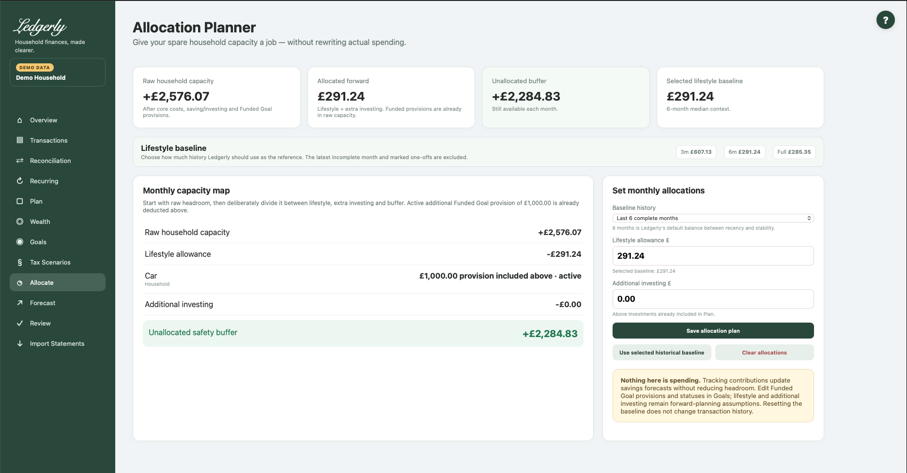

# Allocate

Open **Allocate** to choose what the Plan's remaining monthly capacity is for: a lifestyle allowance, additional investing and a safety buffer. It changes forward assumptions, not historical spending.

## Set allocations

1. Review raw capacity. Active additional Funded Goal provision is already deducted here.
2. Choose three months, six months (default) or full-history lifestyle context.
3. Set a deliberate lifestyle allowance, or use the selected historical baseline.
4. Set investing **above** the saving/investing already included in Plan.
5. Where Tracking Goals are listed, optionally update their monthly savings-forecast contributions.
6. Select **Save allocation plan** and check the unallocated buffer.

## Fields and choices

| Field | Defaults, required values and validation | What changes |
|---|---|---|
| Baseline history | Default six months;3m,6m,full; invalid → 6m | Shared historical lifestyle selection with Plan |
| Lifestyle allowance £ | Default selected baseline unless saved override; zero or positive; £ values with optional grouping commas | Forward allocation assumption; not transaction history |
| Tracking goal contribution £ | Current monthly savings contribution; zero or positive; shown only Tracking Goals | Updates goal forecast contribution without extra headroom deduction |
| Additional investing £ | Default 0; zero or positive; above Plan saving | Forward additional investing assumption |

## Calculation and dependencies

Allocated forward = lifestyle allowance + additional investing. Unallocated buffer = Plan raw headroom − allocated forward. Funded provisions are shown for context but not subtracted again. Tracking contribution fields update their forecasts without changing this buffer.

**Example:** raw headroom £1,900, lifestyle £900 and extra investing £250 leave £750 unallocated. A £600 Funded Goal already in the raw figure must not be deducted another time.

## Baseline and clearing actions

**Use selected historical baseline** removes your saved lifestyle override and uses the selected reference. It leaves extra investing and goal contributions intact.

**Clear allocations** removes lifestyle/extra-investing overrides, restores lifestyle to the selected baseline and sets nonarchived Tracking Goal contributions to zero. It does not delete transactions, the underlying Plan or goals, and does not change Funded Goal provisions/statuses. Review these effects before using it merely to change lifestyle.

An over-allocated warning means the chosen forward assumptions exceed raw capacity. Reduce assumptions or use Forecast to explore alternatives; it does not initiate borrowing or payments.

Common mistakes: entering all existing investing again as additional investing, treating a Tracking contribution as a new reserve, or expecting Allocate's allowance to overwrite Plan's separate planned lifestyle field. The baseline history selection is shared with Plan, but those allowance fields are distinct.

Related: [Goals](goals.md), [Plan](plan.md), [Forecast](forecast.md), [FAQ](../faq.md), [troubleshooting](../troubleshooting.md#unexpected-headroom).
