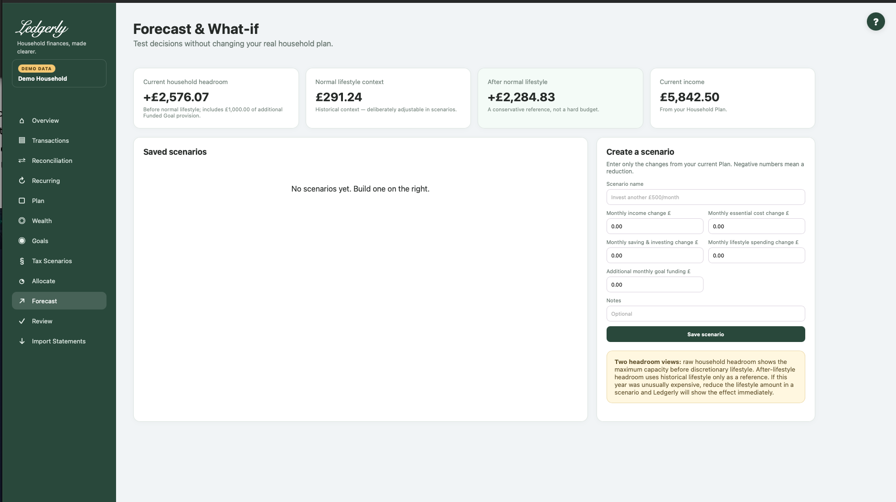

# Forecast & What-if

Open **Forecast** to test a monthly change without altering the real Plan. It is a monthly capacity comparison, not a long-range investment-growth or property decision model. The Capital Decision Modeller is not available in the visible v3.8.5 interface.

## Build a scenario

1. Give the scenario a name, such as **Reduced income example**.
2. Enter only changes from the current Plan. Use plain numbers, for example `-500` rather than a £ symbol or grouping commas.
3. Enter income, essential costs, saving/investing, lifestyle and additional goal funding changes where relevant; leave unchanged fields at zero.
4. Add optional notes and select **Save scenario**.
5. Review raw headroom, after-lifestyle capacity and the change versus the current position.
6. Open Edit to change assumptions; **Archive** hides the scenario. There is no archive-restore UI.

## Fields and choices

| Field | Defaults, required values and validation | What changes |
|---|---|---|
| Scenario name | Required, stripped | Creates/edits saved hypothetical scenario |
| Monthly income change £ | Default 0; plain numeric input; negative allowed | Adds to base Plan expected income |
| Monthly essential cost change £ | Default 0; negative allowed | Adds to base core costs |
| Monthly saving and investing change £ | Default 0; negative allowed | Adds to base Plan saving/allocations |
| Monthly lifestyle spending change £ | Default 0; negative allowed | Adds to selected historical baseline, result floored0 |
| Additional monthly goal funding £ | Default 0; signed amounts accepted by server even though field says Additional | Extra scenario reserve only, does not change Goals |
| Notes | Optional trimmed or null | Records scenario assumptions |

## How the comparison works

Scenario income/core costs/saving each equal the current Plan amount plus the entered change. The lifestyle assumption is the selected historical reference plus its change, floored at zero. Scenario raw headroom subtracts current additional Funded Goal provision and the extra scenario goal funding once. After-lifestyle headroom subtracts scenario lifestyle; the displayed difference compares it with the real Plan's after-lifestyle reference.

A saved scenario recalculates against the **current** Plan every time it is viewed. It is not a frozen historical copy. It does not use Allocate's saved lifestyle allowance as its baseline.

**Example:** current after-lifestyle capacity £1,000. Income falls £500/month and lifestyle falls £200/month. The scenario has £700 after lifestyle, £300 less than the current reference, provided other assumptions remain unchanged.

## Avoid misreading the result

Negative values mean a reduction in that input; reducing a cost increases capacity while reducing income decreases it. The additional goal-funding field accepts signed changes in the current implementation, so review the sign carefully. It does not update the real goal or its saved balance.

Changing a scenario does not change transactions, Plan or real goals. To adopt a decision, deliberately edit the real underlying screen afterward. If a saved result changes unexpectedly, check whether Plan or the baseline history changed since the last visit.

Related: [Plan](plan.md), [tax scenarios](../tax/index.md), [FAQ](../faq.md), [troubleshooting](../troubleshooting.md#unexpected-headroom).
