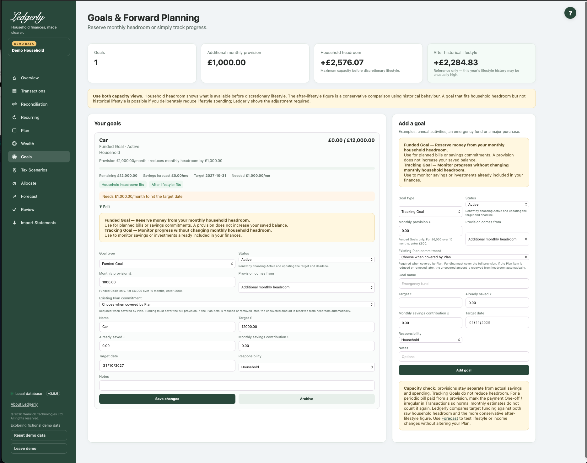

# Funded Goals and Tracking Goals

Open **Goals** to reserve monthly capacity for a commitment or monitor progress toward a target. Both types live on the same page, with editable type, status and responsibility.

## Choose the right type

**Funded Goal — Reserve money from your monthly household headroom.** Use it for a planned bill or an additional savings commitment. A £6,000 target over ten months can have a £600 monthly provision.

**Tracking Goal — Monitor progress without changing monthly household headroom.** Use it for existing savings or an investment target already reflected in your finances. Track the target, saved amount, contribution and projected date without another reserve.

**All existing goals become Tracking Goals on upgrade.** Their balances, targets, contributions, dates, responsibility and notes remain. Choose Funded explicitly when you want an additional commitment.

## Create or edit a goal

1. Choose a type and status. New goals default to Tracking and Active.
2. For Funded, enter a monthly provision and choose where it comes from.
3. Give it a name and positive target. Enter actual money already saved separately.
4. Enter a monthly savings contribution if you want a savings forecast; it is independent of provision.
5. Optionally choose a target date and notes, assign responsibility, and select **Add goal**.
6. On a card, open **Edit** to change the same fields and select **Save changes**.

## Fields and choices

| Field | Defaults, required values and validation | What changes |
|---|---|---|
| Goal type | Default Tracking Goal; choose Tracking or Funded. Existing goals become Tracking. | Determines whether active provision can reduce headroom |
| Status | Default Active; choose Active, Paused or Completed. | Only Active Funded provision is reserved; does not alter actual balance |
| Monthly provision £ | Default 0; £ values and grouping commas accepted; zero or positive | Monthly planning reserve, NOT actual savings progress |
| Provision comes from | Default Additional monthly headroom; choose this or Already covered by Plan. | Additional headroom or coverage from existing Plan commitment |
| Existing Plan commitment | Blank default; active funded plan-covered requires valid option and enough remaining amount after other active linked goals | Links an existing Plan allocation, approved recurring commitment or additional household savings target, preventing repeated use of the same amount |
| Goal name | Required; cannot be blank after surrounding spaces are removed | Creates/edits goal label |
| Target £ | Required; greater than zero; £ values and grouping commas accepted | Progress target |
| Already saved £ | Default 0; zero or positive; may exceed target | Manual actual savings progress; never auto-accrued |
| Monthly savings contribution £ | Default 0; zero or positive | Drives projection/on-track, separately from provision |
| Target date | Optional date-picker value; a past date is accepted but the calculation uses at least one month | Used for needed monthly amount |
| Responsibility | Default Household or one active household financial member | Assigns economic responsibility for extra provision |
| Notes | Optional; spaces are trimmed and a blank leaves no note | Additional user context |

## Provision is not actual saving

A provision is a financial planning commitment. Ledgerly does not create a bank transaction, transfer money or add to **Already saved**. Update the actual amount when money has genuinely been set aside; do not increase it merely because another month has passed.

The **Monthly savings contribution** drives the projected savings date and on-track message. The **Monthly provision** changes headroom. For this reason a fully provisioned goal with a savings contribution of zero can still show “Needs …/month” and no savings forecast. These are separate signals, not automatic accrual.

## Avoid double counting

Choose **Already covered by Plan** and select an existing cash/investment allocation, approved fixed/saving recurring item or additional household savings target. The chosen item must have enough available monthly coverage after other linked active goals. Multiple goals cannot reuse the same covered amount.

Ledgerly adds only any uncovered provision. If the linked Plan amount is later reduced or removed, the uncovered amount is reserved automatically; inspect the goal's displayed extra impact. A partly covered new commitment can be represented as separate fully covered and additional goals.

For a periodic bill paid from provided money, keep the actual bank payment, then explicitly **Mark one-off** in Transactions so normal-month history does not treat it as a second independent commitment. If it is already an approved recurring Plan bill, link the goal to that commitment instead. Ledgerly never silently rewrites historical payments.

## Progress and dates

Remaining = max(0, target − saved). Progress = saved ÷ target, capped at 100%. With a date, Ledgerly counts calendar-month difference, adds a month when the target day is later than today's day, and uses at least one month. Needed monthly saving is remaining divided by those months, rounded up to the next penny.

Projected months = remaining divided by the monthly savings contribution, rounded up. The projected date adds calendar months, clamping at month end where necessary. A past target date is accepted but still uses at least one month; update stale deadlines.

Capacity-fit checks compare additional required funding with current headroom, allowing for the provision already reserved for an active Funded Goal. They are not proof that every target can be funded together.

## Pause, complete, renew or archive

| Goal state | Extra headroom effect |
|---|---|
| Active Funded | Uncovered monthly provision is deducted |
| Paused Funded | No current extra deduction |
| Completed Funded | No current extra deduction |
| Tracking, any status | No extra deduction |

Reaching the target **does not** complete or stop a goal automatically. In Edit, select **Paused** or **Completed** to stop its provision. To renew, choose **Active**, set the next target/deadline and deliberately review the actual saved balance. Ledgerly does not reset it.

**Archive** hides the goal and stops its extra provision. There is no archive-restore control in the current UI, so use Pause if you may want to resume it.

## Worked example

With £2,000 headroom before a new goal, a £600 active additional provision leaves £1,400. Its saved balance stays £0 unless you update it. Pause restores headroom to £2,000. Converting it to Tracking also removes the extra reserve. If Plan already includes the same £600 and the goal is linked to that commitment, the goal adds no second £600 deduction.

Related: [Plan](plan.md), [Allocate](allocate.md), [FAQ](../faq.md#funded-and-tracking-goals), [headroom troubleshooting](../troubleshooting.md#unexpected-headroom).
