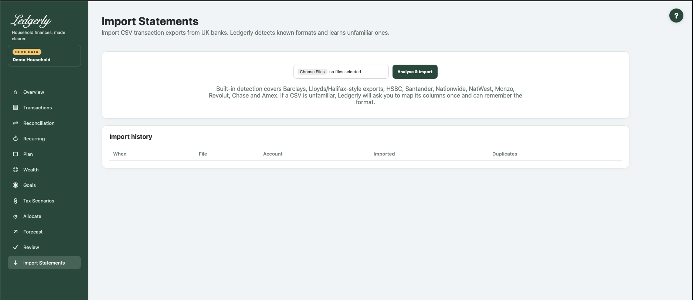

# Bank and card statement imports

Open **Import Statements** to add CSV transaction exports. Ledgerly has no Open Banking feed and does not import PDF statements, Excel workbooks, OFX or QIF. Keep original CSVs; avoid opening and re-saving them in a spreadsheet before importing.

## Import a known format

1. Export transaction CSV from the provider.
2. Choose one or more files and select **Analyse & import**. The combined upload request is limited to **20 MiB**, not 20 MiB per file.
3. Inspect parsed/new/duplicate counts, account, owner and status for each result.
4. If a mapping page opens, complete it and then import any remaining files separately. Processing stops at the first unfamiliar file in a batch; later files are not silently completed.
5. Open Review, Transactions, Reconciliation and Recurring to check the result.

| Field | Defaults and validation | Effect |
|---|---|---|
| Choose Files | Required; default No files selected. Multiple files accepted. Browser restricts .csv/text/csv; server attempts CSV parsing. Flask MAX_CONTENT_LENGTH 20 MiB per request. | Analyse and import each recognized file or open mapping for first unfamiliar file. |

## Supported formats: what detection means

| Format family | Required distinguishing layout | Important convention |
|---|---|---|
| Barclays dedicated parser | First headers Number, Date, Account, Amount, Subcategory; Memo content | DD/MM/YYYY dates; signed amounts; account named Barclays |
| Chase UK dedicated parser | Opening “Transactions for period” line, then Date, Transaction Type, Transaction Description, Amount, Currency, Balance | Long month-name dates; signed amounts; uploaded files currently normally map to Chase |
| American Express dedicated parser | Date, Description, Card Member, Account #, Amount | DD/MM/YYYY; positive purchase amounts become outgoing, credits become incoming; account named Amex |
| NatWest dedicated parser | Date, Type, Description, Value, Balance, Account Name, Account Number | Short/long month-name dates; signed Value; account named NatWest |
| Lloyds/Halifax-style detection | Sort code plus Debit amount and Credit amount | Header heuristics/generic mapping, not a dedicated parser for every export |
| HSBC / Nationwide detection | Paid out / Paid in; Nationwide also Transaction type | Header heuristics |
| Monzo detection | Transaction ID and Local amount | Header heuristics |
| Revolut detection | Started date, Completed date and Product | Header heuristics |
| Santander-style detection | Common date/description/amount layout | Generic heuristic; a similar generic CSV can be labelled Santander |

A recognised bank name does not mean every account/export version is supported. Bank formats change; use the mapper when it appears. Files use comma-separated columns; there is no delimiter/locale selector. Use GBP transaction exports: currencies can be stored, but totals and transfer matching do not perform exchange conversion.

## Map an unfamiliar CSV

The mapper shows the first eight data rows. Confirm institution, a meaningful unique account name, account type and financial-member owner. Then map **Date**, **Description / merchant** and either **Signed amount** or **Money out / debit** and/or **Money in / credit**.

| Field | Defaults and validation | Effect |
|---|---|---|
| Institution | Browser required; server defaults generic; default Detected suggestion or blank. Stripped/lowercased; server falls back generic. | Institution identity and part of account-key fingerprint. |
| Account name | Browser required; server supplies institution title default; default Blank. Stripped; default title of institution (or Imported account fallback). | Find/create account using exact account name + institution; part of fingerprint identity. |
| Account type | Required; default current. Database account_type constraint (additional schema types exist but are not offered). Choices: current, savings, credit_card, investment, other. | New account type; existing matching account is reused rather than type updated. |
| Owner | Optional; default Household / unknown (blank). Lookup by exact member name; absent/unmatched does not change ownership. Choices: Blank or active financial member names. | Assigns matched account owner when selected. |
| Date * | Required; default Suggested matching source header or Not used. Date and Description and at least one of Amount/Debit/Credit required by parser. If Amount mapped, it takes precedence. Blank mapped Amount row skipped. Choices: Not used + source CSV header names. | Booking date parsed using supported auto formats. |
| Description / merchant * | Required; default Suggested matching source header or Not used. Date and Description and at least one of Amount/Debit/Credit required by parser. If Amount mapped, it takes precedence. Blank mapped Amount row skipped. Choices: Not used + source CSV header names. | Raw description retained; categorization learns from it. |
| Signed amount | Optional; default Suggested matching source header or Not used. Date and Description and at least one of Amount/Debit/Credit required by parser. If Amount mapped, it takes precedence. Blank mapped Amount row skipped. Choices: Not used + source CSV header names. | Signed amount, then optional sign inversion. |
| Money out / debit | Optional; default Suggested matching source header or Not used. Date and Description and at least one of Amount/Debit/Credit required by parser. If Amount mapped, it takes precedence. Blank mapped Amount row skipped. Choices: Not used + source CSV header names. | Used as absolute money out if Signed amount unmapped. |
| Money in / credit | Optional; default Suggested matching source header or Not used. Date and Description and at least one of Amount/Debit/Credit required by parser. If Amount mapped, it takes precedence. Blank mapped Amount row skipped. Choices: Not used + source CSV header names. | Money in if Signed amount unmapped. |
| Transaction type | Optional; default Suggested matching source header or Not used. Date and Description and at least one of Amount/Debit/Credit required by parser. If Amount mapped, it takes precedence. Blank mapped Amount row skipped. Choices: Not used + source CSV header names. | Optional transaction type; participates in duplicate fingerprint. |
| Balance | Optional; default Suggested matching source header or Not used. Date and Description and at least one of Amount/Debit/Credit required by parser. If Amount mapped, it takes precedence. Blank mapped Amount row skipped. Choices: Not used + source CSV header names. | Optional balance parsed but not persisted by import_transactions; not a live balance feature. |
| Currency | Optional; default Suggested matching source header or Not used. Date and Description and at least one of Amount/Debit/Credit required by parser. If Amount mapped, it takes precedence. Blank mapped Amount row skipped. Choices: Not used + source CSV header names. | Optional currency, GBP by default; no conversion to GBP. |
| Reference / transaction ID | Optional; default Suggested matching source header or Not used. Date and Description and at least one of Amount/Debit/Credit required by parser. If Amount mapped, it takes precedence. Blank mapped Amount row skipped. Choices: Not used + source CSV header names. | Optional reference saved but does not participate in duplicate fingerprint. |
| Amount convention | Required; default signed. Only expenses_positive causes sign inversion. Choices: signed — positive money in, negative money out, expenses_positive — positive values spending. | Inverts a mapped signed-amount column; separate debit/credit columns already determine signs. |
| Remember this CSV format | Optional; checked by default. Only value 1 stores/updates profile. | Stores mapping, account, institution, owner using normalized header signature. |
| Format name | Optional; default Blank; server uses Institution CSV. Optional display label. | Names learned format (header structure, not label, is the matching key). |

If Signed amount is mapped, it takes precedence over debit/credit and rows with blank signed amounts are skipped. For separate columns, amount = credit minus the absolute debit. Select **Positive = spending** only for signed-amount formats that use that convention; it does not reverse debit/credit columns.

Optional type, currency and reference can help retain source information. Currency defaults to GBP. Balance may be parsed but is **not stored as an account balance** by the importer. Format name labels a saved profile; Remember is checked by default. Select **Import using this mapping** after reviewing the preview. **Cancel** returns to Imports; it is not a guaranteed deletion of the pending upload.

### Accepted generic dates and amounts

Generic parsing accepts `DD/MM/YYYY`, `DD/MM/YY`, `YYYY-MM-DD`, `DD Mon YYYY`, `DD Month YYYY`, `DD-MM-YYYY`, and the two timestamp forms `YYYY-MM-DD HH:MM:SS` and `DD/MM/YYYY HH:MM:SS`. Day/month formats are UK-style; there is no automatic US month/day option.

Use ordinary decimal pounds; £ symbols and grouping commas are handled by monetary parsing. Decimal-comma notation, parentheses for negatives and trailing CR/DR notation are not supported generic conventions. Individual bank parsers can be narrower than the generic parser.

## Multiple accounts and remembered formats

Multiple account records are supported. Generic mapping lets you give an account a distinct name and choose an owner, but existing name+institution accounts are reused. Choosing a new type does not retype an existing account.

Native detection currently uses fixed bank account names rather than account numbers. In particular, separate same-bank accounts are not reliably created just by renaming native CSV files; there is no force-mapper button for a detected native file. Automatic imports can assign the first active member as owner. Verify ownership rather than assuming it follows the statement holder.

A remembered profile is keyed by the ordered column layout and reuses its saved **account and owner**, not just column choices. Two accounts with the same headers can therefore be sent to the same account. Learned formats are listed read-only; there is no profile-edit/delete chooser in the current UI. Test one file before bulk imports and contact support for ambiguous same-bank/account setups.

## Duplicate protection

Ledgerly fingerprints the account identity, date, amount, currency, raw description and transaction type. Overlapping periods normally count known transactions as duplicates rather than adding them again. File name, transaction reference, row number and balance do not determine transaction uniqueness.

**Example:** importing the same unchanged CSV twice should show new rows first, duplicates second. Two genuine identical purchases on the same day can also collapse if all fingerprint values match. Conversely, changed descriptions/types/account identity can make the same real payment look new. Check totals/counts and original CSVs, not just the duplicate label.

## Merchant cleanup, refunds and transfers

Raw descriptions remain; display merchants have whitespace/ending-location cleanup and are grouped by stable families. Review can learn safe category prefixes, and Transactions can correct one entry or Merchant + future. Keep expense refunds in the corresponding expense category so they offset spending. Import both sides of transfers/card settlements and inspect Reconciliation; matching requires equal/opposite amounts across accounts within three days and can leave ambiguous cases unmatched.

Import history shows recent runs (up to 30). It is not a complete export or undo system. There is no bulk import undo or transaction deletion UI. If totals or ownership are wrong, stop further imports and retain the result/error. Do not delete the database or send an unredacted CSV to support.

Related: [Review](review.md), [Reconciliation](reconciliation.md), [FAQ](../faq.md#statement-imports-and-accounts), [import troubleshooting](../troubleshooting.md#import-failures).
