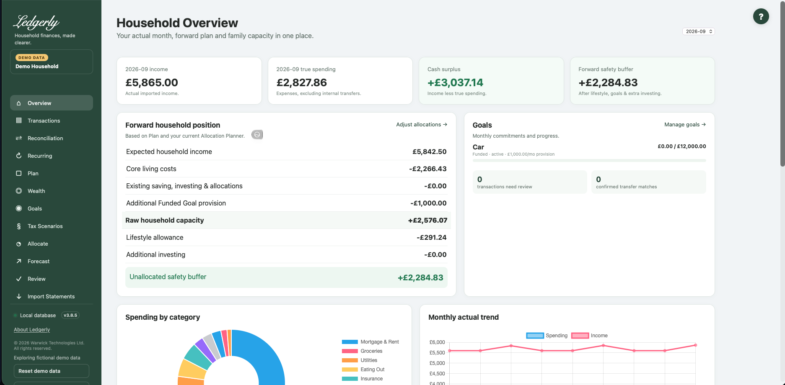

# Overview

Use **Overview** in the sidebar for a household-level check of what actually happened and what the current plan leaves available. This is a summary screen; maintain its underlying data in the relevant guide below.

## Choose an actual month

## Fields and choices

| Field | Defaults, required values and validation | What changes |
|---|---|---|
| Month selector | Optional YYYY-MM; default latest imported transaction month; absent history  →  empty | Changes actual transaction summary, category breakdown and latest monthly headlines; forward Plan position remains current |

The default is the latest month containing imported transactions. A different month changes actual income, spending and category detail. It does **not** rewind the forward Plan. The latest-transactions list remains a list of the most recent records.

## Read the actual cards

- **Income:** positive credits assigned to an income category.
- **True spending:** net expense-category amounts. Refunds credited to an expense category reduce spending.
- **Cash surplus/deficit:** income minus true spending. Regular investing is not included as consumption in this figure.
- **Forward safety buffer:** the current Plan's headroom after Allocate's lifestyle allowance and extra investing. This is a planning estimate, not the balance in a bank account.

**Example:** £4,000 income and £2,500 net expense spending produce £1,500 cash surplus. A £500 internal transfer does not add spending; a £100 expense-category refund reduces spending to £2,400.

## Understand the forward household position

Expected income minus core costs, Plan saving/investing/cash allocations, additional savings and any additional active Funded Goal provision gives raw headroom. Allocate then subtracts lifestyle allowance and extra investing. Funded provision is already included once; Tracking contributions add no further deduction.

The Goals summary shows balances, targets, type/status and contribution or provision. Use **Manage goals** to edit them. **Adjust allocations** opens Allocate. [Worked example](../planning/example.md).

## Charts and account information

Spending by category displays up to the ten largest positive net expense totals. The actual trend spans imported months. Account transaction counts and imported flows help you check coverage; imported flow is not a verified current bank balance. Wealth values are separately maintained.

There is no Save action here. Importing or editing records and changing Plan/Goals/Allocate causes these summaries to recalculate on the next visit. If figures look wrong, check selected month and household first, then [categories](transactions.md), [transfers](reconciliation.md) and [headroom troubleshooting](../troubleshooting.md#unexpected-headroom).

Related: [Plan](plan.md), [FAQ](../faq.md), [limitations](../limitations.md).
