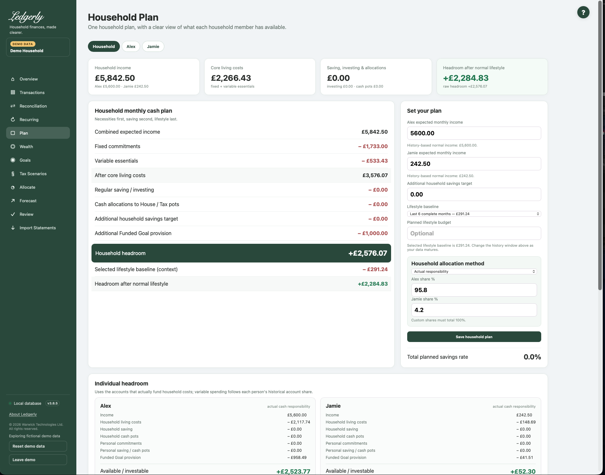

# Household Plan

Open **Plan** to model an ordinary future month. It combines expected income, fixed commitments, variable essentials, saving/investing, cash allocations and Funded Goals. It is a capacity estimate, not a bank balance or payment instruction.

## Set or review your plan

1. Enter expected monthly income for each financial member. The history-based number is context; a saved override remains until you change it.
2. Review approved fixed commitments and regular investing from Recurring.
3. Inspect variable-essential categories. Use **Audit** to see included transactions and excluded one-offs; enter an override only when useful.
4. Choose the lifestyle baseline and, optionally, a separate planned lifestyle budget.
5. Choose the household allocation method and responsibility on each relevant row.
6. Set any additional household saving that is not already covered elsewhere, then **Save household plan**.
7. Check both household and member tabs after saving, especially after a validation error.

## Fields and choices

| Field | Defaults, required values and validation | What changes |
|---|---|---|
| Household/member tab | GET; household default; active member id only; invalid  →  household | Selects individual breakdown without changing household budget |
| Expected monthly income per member | History-based median positive monthly income excluding latest imported month, override saved; blank posted means0; must be zero or positive | Changes household expected income |
| Additional household savings target | Default 0; zero or positive; accepts £ values with optional grouping commas input | Adds separate household saving commitment |
| Lifestyle baseline | Default six months; 3m,6m,full; invalid  → 6m | Shared with Allocate, changes lifestyle context |
| Planned lifestyle budget | Optional, blank clears; zero or positive | Shows buffer after chosen lifestyle in Plan, distinct from Allocate allowance |
| Household allocation method | Default Actual responsibility; choose Actual, Proportional to income, Equal split or Custom split. Invalid selections fall back to Actual. | Changes member share calculations, not household total |
| Member share % | Used/saved only custom model; each0–100; sum100 within0.05 | Splits household costs/provisions by entered shares |
| Responsibility on fixed/investment row | Current scope; household or a named active financial member | Economic household/personal responsibility, account ownership unchanged |
| Variable category Plan £ | Blank restores history median; zero or positive; accepts GBP commas/symbol | Overrides essential category estimate |
| Variable category responsibility | Household default or a named active financial member | Assigns essential category commitment household/personal |
| Existing allocation £/month | Existing stored amount, zero or positive | Changes existing investment/cash pot reservation |
| Existing allocation responsibility | Household or a named active financial member | Assigns existing allocation economically |
| Audit history month link | GET on audit; latest complete imported month default | Shows category month detail and excluded one-offs |

## How household headroom is calculated

**Expected income − fixed commitments − variable essentials − regular saving/investing − cash allocations − additional household savings − additional active Funded Goal provision = household headroom.**

Subtracting the selected historical lifestyle baseline gives **headroom after normal lifestyle**. A separate optional planned lifestyle budget gives a Plan-specific buffer; it does not automatically replace Allocate's lifestyle allowance.

Savings rate uses regular saving/investing, cash allocations and additional household savings divided by expected income. Funded provision is not automatically included in that savings-rate numerator because a provision can be for a future expense.

## Where estimates come from

History-based income is the median positive monthly income for each owner, excluding the latest imported month. Variable essentials use category medians over complete-history months, with zero spend where a category is absent in an existing month. Approved fixed merchant families and marked one-offs are excluded from these history estimates.

Lifestyle is the **sum of category medians** over the selected last three, last six or all available history months. It is not the median of total household spending. The latest imported month is always omitted as the application's incomplete-month convention—even if that month is already complete on the calendar. A month with no imported transactions is not invented to fill a gap.

The default history window is six months. Early estimates based on little or missing history need particular care. A high historical lifestyle reference is context, not a requirement to spend that much again.

## Household and member responsibility

- **Actual responsibility:** shared fixed costs/investing follow the paying account owner. Variable costs follow historical account shares, falling back to income shares. Additional household saving and household Funded provision use income shares because no paying account is specified.
- **Proportional to income:** shared commitments follow each member's income share.
- **Equal split:** shared commitments are split equally.
- **Custom split:** entered percentages must total 100% (a small rounding tolerance is allowed).

Personal items stay with their responsible member in each model. Account ownership and economic responsibility are different concepts. If there is no valid paying owner, individual breakdowns may not reconcile to the household; general shared-cost rounding can also differ by a few pence. Funded provision itself distributes remainder pennies to keep its member total exact.

## Cash allocations and double counting

Existing allocation rows can be adjusted, but there is no create/delete/name/source-account editor for cash pots in this release's visible UI. Fresh households do not receive example House/Tax/child investment pots. Use the additional savings target or a Funded Goal when suitable; do not assume those old template labels create pots automatically.

**Example:** income £5,000 less £2,000 core costs, £300 regular investing, £200 additional saving and £600 funded provision leaves £1,900 raw headroom. A £900 lifestyle reference leaves £1,000 after lifestyle. Linking that £600 goal to an already included £600 Plan commitment avoids subtracting it twice.

Common mistakes: confusing income history with a saved income override, mixing per-occurrence and monthly amounts, duplicating a saving commitment across Plan and Goals, or treating a scenario as the real Plan. A rejected Plan save can leave some earlier fields saved; review the whole form after correcting a validation error.

Related: [planning relationships](../planning/index.md), [Goals](goals.md), [Allocate](allocate.md), [FAQ](../faq.md), [troubleshooting](../troubleshooting.md#unexpected-headroom).
