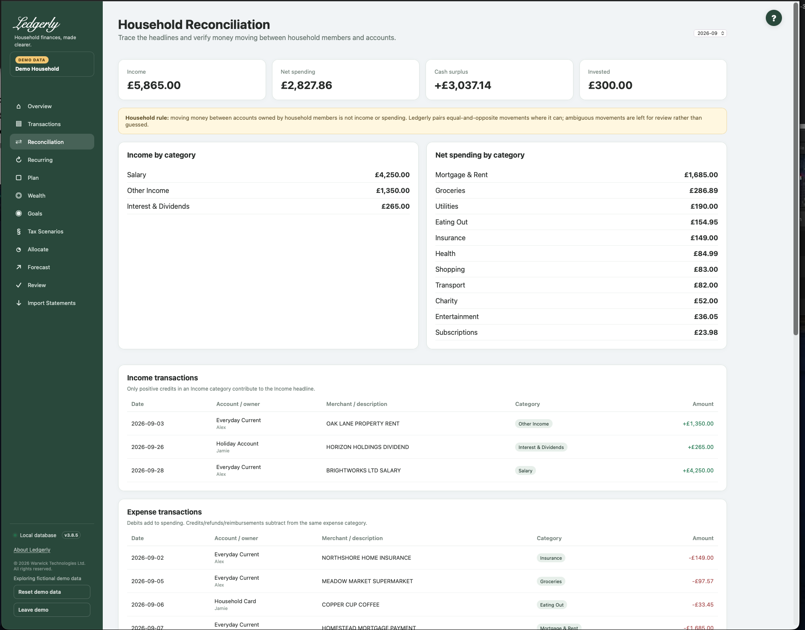

# Reconciliation

Open **Reconciliation** to check money moving between household accounts and card repayments. A transfer between your accounts is not a second household income or expense. This screen is not opening/closing bank-balance reconciliation.

## Controls and actions

## Fields and choices

| Field | Defaults, required values and validation | What changes |
|---|---|---|
| Month selector | Latest imported month default | Filters reconciliation detail and candidate/confirmed transfer pairs |
| Confirm / Reject match | Existing match_id required; confirm_match or reject_match | Confirms learned account relationship or permanently rejects that suggested pair |

Choose a month; the latest imported month is the default. Inspect both accounts, dates and amounts in **Transfer matches to review**. Select **Confirm** when the entries are the same movement; select **Reject** when the suggested pair is unrelated. Confirmed matches and unmatched transfer entries are shown separately.

## How suggestions work

Ledgerly searches different accounts for exact equal-and-opposite amounts within **three calendar days**. Date proximity and description hints help choose a candidate; equally plausible alternatives are left unpaired. Credit-card settlements follow bank debit to card credit, not a card purchase debit to an unrelated bank credit.

Confirming also teaches Ledgerly an account-direction/match-type relationship so later qualifying pairs can be confirmed automatically. This is not an arbitrary fuzzy amount match. Importing both accounts makes it more useful.

!!! note "A candidate can already affect spending"
    Suggested transfer entries can be categorised as transfers before you confirm. Rejecting a pair removes that pairing but does not restore previous categories. Check Transactions if the entries were genuine income/expenses. There is no confirmed-match Undo or manual choose-two-rows matching control.

## Understand the totals

Income counts positive income-category credits. Net spending is expense debits less expense refunds. Cash surplus is income minus net spending. Invested counts outgoing investment-category amounts separately. Transfer volume represents movements, not additional consumption. A pair may appear when either side touches the selected month, while transaction detail follows booking month.

**Example:** £500 leaves a current account on 4 June and arrives in a savings account on 5 June. With both imported, matching can exclude the £500 movement from household spending. If only one account is imported, the unmatched side may simply represent incomplete history.

## When a pair looks wrong

Check household, source/destination accounts, dates, amounts and whether another identical amount created ambiguity. Reject the suggestion only after examining both sides. Do not delete databases or re-import everything to remove a candidate. Foreign-currency transfers are not safe to reconcile numerically: the engine does not compare/exchange currencies.

Related: [Transactions](transactions.md), [imports](imports.md), [FAQ](../faq.md), [troubleshooting](../troubleshooting.md#transfers-and-duplicates).
