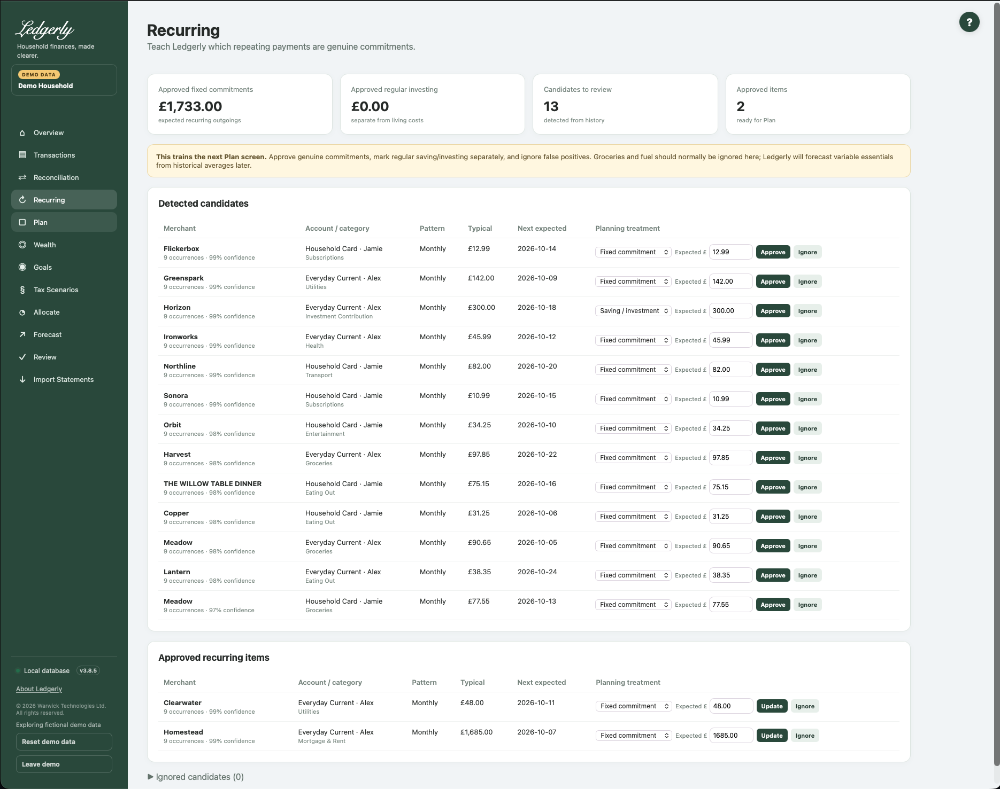

# Recurring Payments

Open **Recurring** after reviewing transactions. Use it to distinguish real repeating commitments from frequent discretionary purchases. Approved fixed and saving/investment entries feed the Household Plan.

## Read the candidate list

Candidates show merchant family, account/owner, category, inferred cadence, occurrences, confidence, typical amount and next expected date. Detection looks at repeated outgoing expense/investment records: typically at least four weekly, three monthly, three quarterly or two annual occurrences, with a sufficiently consistent pattern. A confidence label is a heuristic, not a guarantee.

## Fields and choices

| Field | Defaults, required values and validation | What changes |
|---|---|---|
| Planning treatment | fixed,investment,variable,discretionary; defaults detected investment for investment category else fixed | Only approved fixed/investment included as fixed/saving amounts in Plan |
| Expected £ | Defaults expected amount or typical; optional blank keeps detected value; plain numeric parsing; invalid text silently retains detected amount | Updates per-occurrence expected amount when Approve/Update used |

## Approve or change a commitment

1. Check the merchant, account and inferred pattern.
2. Choose **Fixed commitment**, **Saving / investment**, **Variable essential** or **Discretionary**.
3. Enter a positive plain-number expected amount **per occurrence** (for example `120.00`). Blank retains the detected amount.
4. Select **Approve**. Use **Update** on approved entries later.
5. Review Plan after saving.

**Ignore** removes a false positive from active recurring items; **Restore** returns it as a candidate for consideration. There is no cadence editor or general add-new recurring form here. Transactions' Make recurring shortcut creates a monthly approved item.

## What reaches Plan?

Approved **fixed** entries become fixed core commitments; approved **saving/investment** entries become regular saving. Variable/discretionary labels do not create additional fixed deductions. Variable essentials and lifestyle context instead come from category history in Plan.

Monthly conversion is weekly × 52 ÷ 12; monthly × 1; quarterly ÷ 3; annual ÷ 12. A £120 annual commitment therefore reserves £10/month in Plan. Recurring's headline sums are per-occurrence amounts; for a mixture of cadences, do not read that headline as a monthly total.

## Common mistakes

Do not approve ordinary grocery/fuel repeats as fixed bills just because they recur; that can overlap with variable estimates. Avoid negative expected amounts. The current expected-amount control does not reject every invalid value consistently: invalid text can retain the detected amount, and zero may fall back to the typical amount in Plan. Check the saved row and Plan rather than relying on the absence of an error.

Related: [Plan](plan.md), [goal coverage](goals.md#avoid-double-counting), [FAQ](../faq.md), [headroom troubleshooting](../troubleshooting.md#unexpected-headroom).
