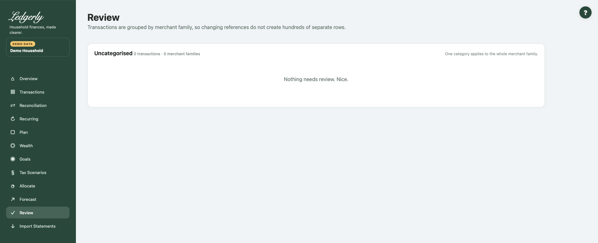

# Review

Open **Review** after importing. It is the categorisation inbox for pending transactions, grouped by merchant family so changing bank references do not necessarily create a separate row for every entry.

## Work through unfamiliar families

1. Read the merchant-family name, sample descriptions, account information and transaction totals.
2. Choose a category for a family you recognise. Leave the blank **Leave for review** choice for anything uncertain.
3. Keep or clear **Remember** as appropriate.
4. Select **Save selected categories** to apply chosen categories to pending entries in those groups.
5. Check Transactions for individual exceptions, then Reconciliation and Recurring.

## Fields and choices

| Field | Defaults, required values and validation | What changes |
|---|---|---|
| Category for merchant family | Default Leave for review (blank) skips; category selected applies to current pending family | Confirms all pending transactions in family |
| Remember checkbox | Checked by default; only stored as prefix rule when safe leading prefix for all samples | Learns category for future imports |

Remember is checked by default. When it is safe to identify the family by a common leading description, Ledgerly can save that category for future imports. It does not guarantee every similar-looking merchant will always match.

## Understand the group

A family can span multiple accounts within the household. Its net total may hide a mixture of debits and credits; use the transaction/debit/credit counts and examples to understand it. Review changes currently pending members of the family. **Merchant + future** in Transactions has a broader effect on all matching household-family entries.

**Example:** several bank descriptions for the fictional Harvest supermarket can be grouped. Categorising the pending family as Groceries confirms those entries. A supermarket refund remains in the same expense category and offsets spending.

The probable-transfers section is informational here; confirm/reject in Reconciliation. An empty Review page means no pending families, not necessarily that all categories, transfers or Plan assumptions are correct.

Common mistakes: applying one category to a mixed-purpose family without inspecting samples, treating Remember as an exact bank-ID rule, or assuming a saved Review category changes the original bank amount/date.

Related: [Transactions](transactions.md), [Reconciliation](reconciliation.md), [imports](imports.md), [FAQ](../faq.md), [troubleshooting](../troubleshooting.md#import-failures).
