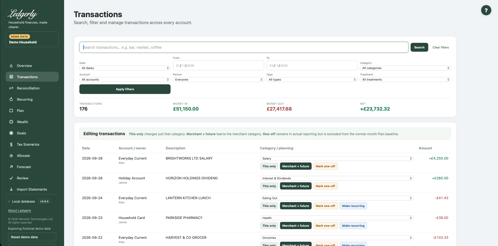

# Transactions Explorer

Open **Transactions** to search across accounts in the selected household, investigate an entry or correct its category and planning treatment. It is not a bank-payment or transaction-creation screen.

## Search and filters

## Fields and choices

| Field | Defaults, required values and validation | What changes |
|---|---|---|
| Search | Optional case-insensitive substring; raw description or cleaned merchant | Filters across all accounts in selected household |
| Date | All dates default; this_month,last_month,this_year,custom in UI | Presets overwrite date_from/to for current date |
| From | Optional ISO date; inclusive ≥ comparison; browser date input | Lower date bound |
| To | Optional ISO date; inclusive ≤ comparison; browser date input | Upper date bound |
| Category | All categories default; numeric ID applied | Filter chosen transaction category |
| Account | All accounts default; numeric ID applied | Filter financial account |
| Person | Everyone default; numeric ID applied | Filters account owner, not economic planning responsibility |
| Type | All types default; income,expense,investment,transfer,ignore | Filter category kind |
| Treatment | All treatments default; normal or one_off | Filter planning treatment |
| Category per transaction | Required existing category for category saves | Changes category of one or merchant family |

Enter part of a raw description or cleaned merchant name and select **Search**. Matching is case-insensitive: a partial word is enough. Combine Date, From/To, Category, Account, Person, Type and Treatment, then select **Apply filters**. **Clear filters** returns to the unfiltered list.

Date presets use the calendar date on the server. Choose a custom range to inspect older imports. **Person** filters the account owner; it does not filter economic responsibility in Plan. Type follows the transaction category's kind: income, spending, investment, transfer or ignored.

The totals cover **all matching records**, but the visible table is limited to the latest **1,000 rows**. Narrow the filters if you cannot see an older entry. Money in/out here includes all matching positive/negative entries; unfiltered transfers can therefore contribute to these totals even though they are excluded from true household spending.

## Correct a category

1. Locate the transaction and choose its category.
2. Select **This only** to change and confirm just that transaction.
3. Select **Merchant + future** only when the category suits the whole merchant family. This changes matching family records in this household and can learn a safe prefix for future imports.
4. Revisit Overview or Plan to inspect the effect.

**Example:** a £40 supermarket refund should use the same expense category as the original shopping. Making it Other Income would overstate income instead of offsetting that spending.

## One-off planning treatment

**Mark one-off** leaves the transaction in actual reporting but excludes it from normal-month Plan estimates and historical lifestyle references. Use it for an exceptional repair or a periodic bill paid from a provision. **Mark normal** reverses that planning treatment.

One-off does not erase the payment, create saving or remove a separately approved recurring commitment. If a recurring Plan item already covers a funded goal, link the goal to that item rather than adding a second reserve.

## Make a payment recurring

For an outgoing expense/investment, **Make recurring** creates or updates an approved **monthly** recurring entry and opens Recurring. Check its amount and type. This shortcut assumes monthly; it is not a cadence selector.

## Limits and common mistakes

There is no UI for changing imported amounts/dates, deleting or splitting transactions, creating custom categories or exporting CSV. Keep the original bank export. Do not use Merchant + future for a merchant that genuinely spans different purposes. Automatic transfer processing can reapply transfer classification in some cases; inspect [Reconciliation](reconciliation.md) before repeatedly changing categories.

Related: [Review](review.md), [imports](imports.md), [FAQ](../faq.md), [import troubleshooting](../troubleshooting.md#import-failures).
