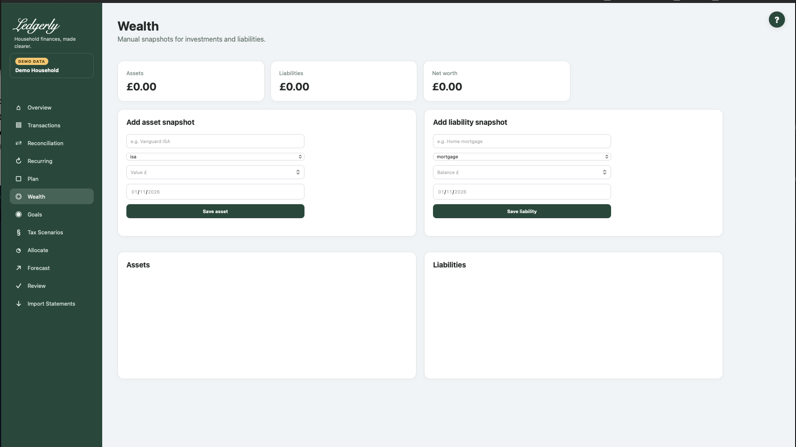

# Wealth & Net Worth

Open **Wealth** to record manual dated snapshots of assets and liabilities. Use it for an investment account, property estimate, cash holding or debt balance that is useful to your household's net-worth picture.

## Add or update a snapshot

1. Choose the asset or liability form.
2. Enter a consistent name and type.
3. Enter a plain numeric value/balance in pounds, such as `2500.00`.
4. Select the actual snapshot date. There is no application-set date default; a browser's date placeholder is not a saved date.
5. Select **Save asset** or **Save liability**.

## Fields and choices

| Field | Defaults, required values and validation | What changes |
|---|---|---|
| Asset or liability name | HTML required, stripped; exact name identifies existing entry | Same named record receives snapshot, not new duplicate entry |
| Asset/liability type | Asset default ISA: isa,sipp,investment,property,cash,other; liability default Mortgage: mortgage,loan,credit_card,other | Type set at initial record creation; same name later retains original type |
| Value £ / Balance £ | Required by the browser; ordinary numbers in 0.01 increments. The application does not consistently reject negative values; use positive amounts. | Snapshot amount in pence |
| Snapshot date | Required date-picker value; the application does not add its own full date validation | Latest date determines displayed snapshot; same name/date replaces amount |

Asset types are ISA (the first/default choice), SIPP, investment, property, cash and other. Liability types are mortgage (default), loan, credit card and other. Use positive asset values and positive amounts owed. The server does not consistently reject negative values, so an accepted negative value is not assurance it was entered correctly.

## What saving does

The exact same name identifies an existing asset/liability. A new date adds another snapshot; the same name and date replaces that snapshot's amount. The displayed current amount is the snapshot with the latest date, not necessarily the one entered most recently. A later entry under the same name does not change the original type.

There is no visible delete/rename/type-edit control or history browser. Use the same name/date to correct an amount, and seek support for other corrections instead of editing the database.

## Calculation and example

Net worth = sum of latest asset snapshots − sum of latest liability snapshots. Assets £50,000 and liabilities £15,000 give £35,000 net worth. These figures are manually maintained; bank imports do not automatically value investments, property or debt, and no exchange-rate conversion is applied.

!!! warning "Check a negative net worth manually"
    The current currency display can omit the minus sign for a negative net-worth result. If liabilities exceed assets, subtract them yourself and treat the difference as negative. This display limitation does not make the debt disappear.

Wealth does not automatically fund goals, set current bank balances, change Plan or populate Tax Scenarios. Do not count the same money as both a separate asset and an included investment total.

Related: [Goals](goals.md), [Tax Scenarios](../tax/index.md), [FAQ](../faq.md), [limitations](../limitations.md).
