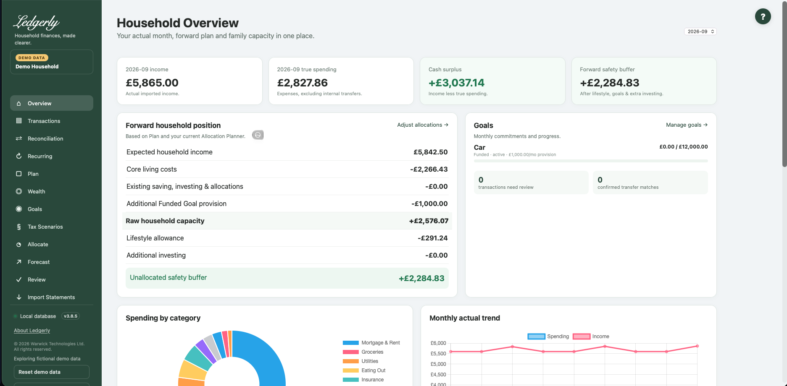

---
hide:
  - toc
  - navigation
---

The official Ledgerly guide · v{{ version }}

# Household finances, made clearer.

Understand where your money goes, plan a normal month and make room for what matters. Start with your bank's CSV statements. Keep your household records on the computer running Ledgerly.

{{ download_button }} <a class="md-button" href="getting-started/">Start your first household →</a>

For macOS and Windows · Early testing release · No Open Banking connection required

<figure class="hero-preview"><figcaption>Inside Ledgerly · fictional Demo data</figcaption></figure>

## Install with confidence
Choose your platform, complete local HTTPS setup and keep existing data safe during upgrades.

[Downloads & checksums](downloads.md) · [Installation](installation/index.md)

## Learn the everyday workflow
Import, review and reconcile. Then build a Plan that reflects how your household actually works.

[Getting started](getting-started/index.md)

## Understand every screen
Find field-by-field instructions, worked examples and the relationships behind Ledgerly's numbers.

[Complete user guide](guide/index.md)

## Find an answer
Resolve import problems, understand headroom and learn what Ledgerly currently does—and where it has limits.

[FAQ](faq.md) · [Troubleshooting](troubleshooting.md)

## One household story, from statements to plans

<strong>Import</strong> → <strong>Review</strong> → <strong>Reconcile</strong> → <strong>Recurring</strong> → <strong>Plan</strong> → <strong>Goals</strong> → <strong>Allocate & forecast</strong>

You do not need to set everything up on day one. A few months of clean transaction history make normal-spending estimates more useful. Ledgerly keeps actual spending, future commitments and what-if scenarios distinct.

## Your data, your computer

Ledgerly stores financial records locally, without a Ledgerly-hosted financial-data account. Installation downloads dependencies; normal installed use can work offline. Local storage is not the same as encrypted storage or a cloud backup. Access controls also have early-release limitations: use Ledgerly only with people you trust.

[Data & privacy](privacy.md) · [Known limitations](limitations.md) · [What changed in v3.8.5](releases.md)

Need help? [help@getledgerly.co.uk](mailto:help@getledgerly.co.uk).
