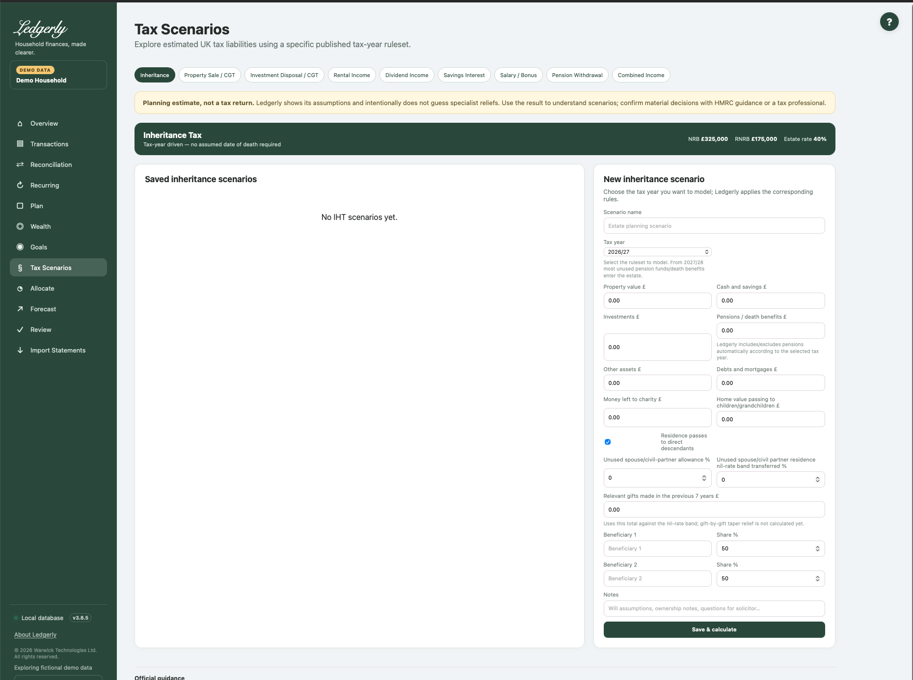

# Tax Scenarios

Open **Tax Scenarios** and choose a tab to save independent annual UK tax-planning assumptions. The nine implemented models are listed below. They do not populate themselves from Wealth/bank records, change the Household Plan, file a return or pay tax.

!!! warning "Application estimates, not a tax return"
    These guides explain the bundled v3.8.5 calculations, not an independently certified tax liability. Future-year options are stored assumptions, not a live legislation service. Specialist reliefs, high-income/band-edge cases and some allowance interactions are simplified. Use current official guidance/professional advice for material decisions.

| Model | Use it to explore |
|---|---|
| [Inheritance](inheritance.md) | Estate assets, debts, allowances and beneficiaries |
| [Property Sale / CGT](property.md) | A simplified disposal gain; no home-relief calculation |
| [Investment Disposal / CGT](investment.md) | A simplified investment gain; no share pooling |
| [Rental Income](rental.md) | Rent, expenses and entered finance costs |
| [Dividend Income](dividends.md) | Annual dividends alongside other income |
| [Savings Interest](interest.md) | Taxable interest alongside other income |
| [Salary / Bonus](salary.md) | Employment Income Tax and employee NI |
| [Pension Withdrawal](pension.md) | A gross withdrawal with an entered tax-free share |
| [Combined Income](combined.md) | Employment, property, interest and dividends together |

## Common workflow

Choose the type, give the scenario a name and select a supported tax year. Enter **annual** amounts; blank monetary fields become zero and negative amounts are rejected. Most tax fields accept a £ symbol/grouping commas. Save & calculate shows a breakdown; saved scenarios can be edited or archived. Archive hides a scenario without a visible restore control. Only Inheritance has a Notes field.

The default year is **2026/27**. Inheritance offers **2025/26 through 2030/31**; other models offer **2025/26, 2026/27 and 2027/28**. Rates do not update from the internet when you open the page. No Scottish-tax selector is implemented.

## Reading results

Check every row, not just the headline. Salary/Bonus headline includes employee NI; Combined Income intentionally excludes it. Do not add standalone scenario tax totals together: the same allowances can be used more than once if you calculate each income source independently.

All worked examples in this guide are fictional values executed against the v3.8.5 engine. They illustrate what this release returns. They are not predictions for a named person's liability.

Current official reference: [HMRC Inheritance Tax](https://www.gov.uk/inheritance-tax), [Capital Gains Tax](https://www.gov.uk/capital-gains-tax/rates), [Income Tax](https://www.gov.uk/income-tax-rates), [savings interest](https://www.gov.uk/apply-tax-free-interest-on-savings). These external rules can change independently of Ledgerly.

Related: [FAQ](../faq.md#planning-and-tax), [known limitations](../limitations.md), [troubleshooting](../troubleshooting.md#tax-or-wealth-results-look-surprising).
